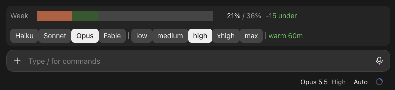

# Weekly Pace & Model Switcher

A Claude Code plugin that shows, above the prompt, whether you are spending your weekly usage faster
than the week is passing, and lets you switch model and effort in one click.



- **Week bar**: one row comparing usage with time. Orange is how much of the weekly all-models limit
  you have used. The rest of the way to how far you are through the week is green when you have room
  to spare, or red past it when you are spending ahead of the week. Beside it, `used% / time%` and a
  verdict: `+N over` (red), `N under` (green) or `on pace` (within 5 points).
- **5h bar**: the same for the 5-hour window, on plans that have one. It shows only while a 5-hour
  window is open; plans without one never see it.
- **Model and effort buttons**: one click runs `/model` or `/effort`; the active ones are highlighted,
  including changes you type yourself.
- **warm Nm / cold**: whether the current model's prompt cache is likely still warm, and for how long.

It works in the Claude desktop app (Code tab), the terminal and the IDE extensions. Usage figures need
a Claude subscription (Pro or Max); without one, only the buttons show.

## Install

### Claude desktop app

1. Click **+** next to the prompt box, then **Plugins**.
2. Choose **Add marketplace** and enter `mm503/claude-weekly-pace-plugin`.
3. Find **weekly-pace** in the list and choose **Add plugin**.

### Terminal

At the Claude Code prompt:

```
/plugin install weekly-pace --marketplace mm503/claude-weekly-pace-plugin
```

Or from a shell:

```bash
claude plugin install weekly-pace --marketplace mm503/claude-weekly-pace-plugin
```

New conversations load it by themselves; in one already open, run `/reload-plugins`.

### From a zip

Download `weekly-pace-<version>.zip` from the
[Releases](https://github.com/mm503/claude-weekly-pace-plugin/releases) page, then either:

- in the desktop app, click **+** next to the prompt box, choose **Plugins** and upload the zip; or
- in the terminal, load it for one session: `claude --plugin-dir weekly-pace-<version>.zip`.

### Uninstall

```bash
claude plugin uninstall weekly-pace@weekly-pace
```

## How it works

- Usage comes from the weekly (`seven_day`) rate-limit reading Claude Code receives with each response.
  The plugin saves the last reading, so a new conversation shows the bar straight away; the first
  response replaces it with live figures. After the weekly reset the bar starts over at 0%.
- Week time is computed from the reset time: the window is the 7 days before it.
- The 5-hour bar comes from the `five_hour` reading, when responses carry one, and its time from the
  5 hours before that window's reset. Past the reset the row goes away until a new request opens the
  next window; a response that reports the week but no 5-hour window removes it.
- Warm/cold is an estimate: the time of the last response on the current model against a 60-minute
  cache lifetime. Each model keeps its own cache, so switching models shows `cold` until it answers.
- The band redraws every 30 seconds, so the time mark and the countdown keep moving between turns.

## Commands it runs

The plugin runs slash commands only when you click one of its buttons, and only these:

- a model button runs `/model <id>` with that button's model id (see `MODELS` below);
- an effort button runs `/effort <level>` with that button's level (`low` to `max`).

It runs nothing on its own: no command at startup, on a timer, or in response to a turn. It also
watches `/model` and `/effort` when you run them yourself, only to highlight the active buttons.

## Customize

Everything is at the top of `weekly-pace/hooks/register.tsx`:

| Constant | What it sets |
| --- | --- |
| `CACHE_TTL_MS` | Prompt-cache lifetime (60 min). Use `5 * 60 * 1000` if your cache lasts 5 minutes. |
| `MODELS` | The model buttons, weakest to strongest: a label and the id passed to `/model`. Update when models change; delete a line to hide a model your plan doesn't include. |
| `EFFORTS` | The effort buttons. |
| `TRACK` | The empty part of the bar, `#454545`, matched to the desktop app's dark theme. Pick a lighter gray if you use a light theme. |
| `USAGE_FILL`, `OVER_FILL` | Usage, and usage past the week's elapsed time: theme keys (`claude`, `error`) so they follow light and dark themes. |
| `HEADROOM_FILL` | The gap from usage up to the week's elapsed time, `#2f5a2a` (dark green). Pick a lighter green if you use a light theme. |

## Develop

```bash
claude plugin validate .
claude plugin test weekly-pace
scripts/package.sh   # builds dist/weekly-pace-<version>.zip
```

To release: bump `version` in `weekly-pace/.claude-plugin/plugin.json`, add a `CHANGELOG.md` entry, then
push a matching tag (`git tag vX.Y.Z && git push --tags`). CI validates, builds the zip and attaches it
to a GitHub release.

## License

MIT
